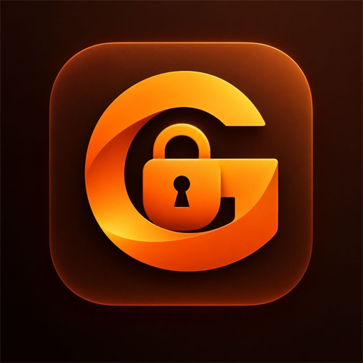

# 🦊 GigaCrypt

<div align="center">
  
  <h1>GigaCrypt</h1>
  <p><strong>Элегантное, надежное и бескомпромиссное шифрование файлов и папок для Windows</strong></p>
  <p><em>Military-Grade File & Folder Encryption with Warm Amber Obsidian Aesthetic</em></p>

  <p>
    <a href="https://github.com/zakiware/GigaCrypt/releases/tag/v1.0.0"></a>
    
    
    
    
  </p>
</div>

---

## 🌟 Обзор | Overview

**GigaCrypt** — это современное приложение для Windows, созданное для бескомпромиссной защиты конфиденциальных данных. Оно объединяет военный уровень шифрования (**AES-256-GCM** с аппаратным ускорением **AES-NI**), инновационную технологию мгновенного шифрования папок на месте (**Zero-Copy In-Place Vault**), изолированную песочницу для безопасного временного просмотра, глубокую интеграцию с Проводником Windows и кинематографичный дизайн в стиле **Ginger Obsidian**.

---

## ✨ Ключевые возможности | Key Features

### 1. 🛡 Военный уровень безопасности (AES-256-GCM)
* **Аутентифицированное шифрование**: Алгоритм `AES-256-GCM` с 128-битным тегом аутентификации гарантирует как конфиденциальность, так и целостность данных — любая попытка несанкционированной модификации файла немедленно блокируется.
* **Стойкая деривация ключа**: `PBKDF2-SHA512` со 100 000 итераций и криптографически стойкой 32-байтной солью (CSPRNG) для надежной защиты от атак по словарю и перебора на GPU/ASIC.
* **Поддержка любых паролей**: Полная поддержка Unicode/UTF-8 (русские, английские символы, спецсимволы, эмодзи) с обязательным строгим минимумом от 6 символов.
* **Криптографический шредер**: Безвозвратное уничтожение оригиналов путем предварительной перезаписи случайными байтами перед удалением.

### 2. ⚡ Мгновенное шифрование папок на месте (In-Place Zero-Copy)
* Больше не нужно ждать копирования гигабайтов данных на другой диск! GigaCrypt сжимает и защищает папки прямо внутри их каталога.
* При блокировке папка превращается в защищенный архив с расширением `.gcrypt` или внутреннее защищенное хранилище `.gigavault`.
* При полной расшифровке гарантируется **100% чистота**: никаких остаточных временных файлов, системных мусорных папок или скрытых файлов `.gigavault`.

### 3. 👁 Изолированный временный просмотр (Sandboxed Temp View)
* Нужно быстро просмотреть или изменить документ в зашифрованной папке без полной дешифрации?
* Функция **«Временный просмотр»** безопасно распаковывает файлы в изолированную временную песочницу и запускает Windows Explorer.
* Оригинальный архив остается заблокированным.
* При завершении просмотра все временные данные немедленно зачищаются шредером.

### 4. 🖱 Интеграция с проводником Windows (Shell Integration)
* **Контекстное меню правой кнопки мыши**:
  * Для файлов: `🔒 Зашифровать в GigaCrypt`
  * Для папок: `🔒 Зашифровать папку в GigaCrypt` и `🔓 Расшифровать папку в GigaCrypt`
* **Ассоциация `.gcrypt`**:
  * Автоматическая привязка файлов `.gcrypt` с индивидуальной 3D-иконкой и мгновенным открытием диалога ввода пароля по двойному клику.

### 5. 🎬 Кинематографичный интерфейс (Ginger Obsidian UI)
* Анимированное видео-интро при первом запуске (`intro.mp4`).
* Элегантный акцент цвета спелого янтаря и имбиря с физическими анимациями (Framer Motion).
* Адаптивный интерфейс: оптимизированные крупные элементы управления и типографика для полноэкранного режима 4K/FullHD и ультракомпактный оконный режим.
* Постоянный бейдж версии `v1.0.0` в правом нижнем углу.

### 6. 🔄 Умное автообновление (GitHub Releases Auto-Update)
* Фоновая ненавязчивая проверка новых версий через официальный GitHub API (`zakiware/GigaCrypt`).
* Окно обновления появляется **только тогда, когда действительно вышла новая версия**.
* Просмотр списка изменений (Changelog) и скачивание установщика в один клик.
* Ручная проверка версии кликом по бейджу в правом нижнем углу.

### 7. 📦 Установщик «Всё включено» (Offline-Ready Modern Installer)
* Красивый NSIS-установщик `GigaCrypt-Setup-1.0.0.exe`.
* **Автоматическая установка системных зависимостей**: установщик проверяет наличие **Microsoft Visual C++ 2015-2022 Redistributable (x64)** и автоматически тихо устанавливает необходимые библиотеки, если они отсутствуют в системе. Программа гарантированно запустится на любом чистом ПК!

---

## 📐 Архитектура файла `.gcrypt` | Format Specification

```
+-----------------------------------------------------------------------+
|  Magic "GCRYPT" (6B)  |  Version (1B)  |  Flags (1B)                  |
+-----------------------------------------------------------------------+
|  PBKDF2 Salt (32B)    |  GCM IV / Nonce (12B)                         |
+-----------------------------------------------------------------------+
|  Encrypted Metadata Payload Length (4B, Big-Endian)                  |
+-----------------------------------------------------------------------+
|  Encrypted Metadata (JSON UTF-8) + Auth Tag (16B)                     |
+-----------------------------------------------------------------------+
|  Encrypted Content Stream (AES-256-GCM) + Content Auth Tag (16B)      |
+-----------------------------------------------------------------------+
```

---

## 🚀 Установка | Download & Installation

### Готовый установщик (Рекомендуется):
1. Перейдите в раздел [**Releases**](https://github.com/zakiware/GigaCrypt/releases).
2. Скачайте файл **`GigaCrypt-Setup-1.0.0.exe`**.
3. Запустите установку. Мастер установки автоматически настроит все компоненты, ярлыки на рабочем столе и контекстное меню.

### Сборка из исходников:
```bash
# Клонирование репозитория
git clone https://github.com/zakiware/GigaCrypt.git
cd GigaCrypt

# Установка зависимостей
npm install

# Запуск в режиме разработки
npm run dev

# Сборка дистрибутива и NSIS-установщика
npm run dist
```

---

## 🛠 Технологический стек | Tech Stack

* **Core Runtime**: [Electron 45](https://www.electronjs.org/) + [Node.js 22](https://nodejs.org/)
* **Frontend**: [React 19](https://react.dev/), [TypeScript](https://www.typescriptlang.org/), [Tailwind CSS v4](https://tailwindcss.com/)
* **Motion & Animations**: [Framer Motion](https://www.framer.com/motion/)
* **Icons**: [Lucide React](https://lucide.dev/)
* **Packaging**: [electron-builder](https://www.electron.build/) + [NSIS](https://nsis.sourceforge.io/)
* **Build Tooling**: [Vite 8](https://vitejs.dev/) + [esbuild](https://esbuild.github.io/)

---

## 📄 Лицензия | License

Проект распространяется под свободной лицензией **MIT License**. См. файл `LICENSE` для подробной информации.

<div align="center">
  <sub>Создано с ❤️ для обеспечения приватности и безопасности ваших данных.</sub>
</div>
